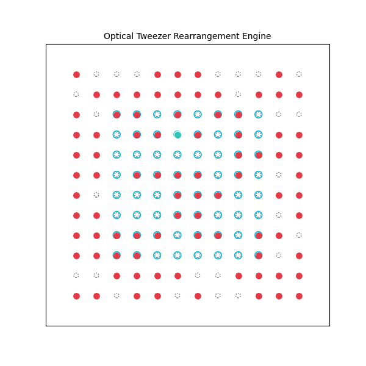

# Collision-Free Optical Tweezer Rearrangement Engine for Neutral Atom Quantum Registers

[](https://Swatee-05.github.io/neutral-atom-tweezer-rearrangement/)
[](https://opensource.org/licenses/MIT)

A deterministic motion-planning and routing pipeline designed to assemble defect-free $N$-qubit neutral atom quantum registers from stochastically loaded optical tweezer arrays.

<p align="center">
  
</p>

---

## Interactive Client & Web Visualizer

Run and test the algorithmic engine directly in your browser:  
👉 **[Launch Interactive Web Simulator](https://Swatee-05.github.io/neutral-atom-tweezer-rearrangement/)**

* **Autonomous Execution:** Solves bipartite matching and routes atoms sequentially using center-outward heuristic scheduling and perimeter-buffered breadth-first search.
* **Manual Control:** Click any static atom (Red) and select an open target trap (Blue ring) to manually execute collision-free shuttling trajectories.

---

## Visual Key & System Schematics

| Marker | Nomenclature | Physical Representation |
| :---: | :--- | :--- |
| <span style="color:#38bdf8; font-weight:bold;">O</span> | **Target Register Site** | Designated spatial coordinates for the $8 \times 8$ ($K = 64$) defect-free quantum register. |
| <span style="color:#f43f5e; font-weight:bold;">●</span> | **Neutral Atom (Stationary)** | Individual neutral atom held at rest within a static optical dipole potential well. |
| <span style="color:#10b981; font-weight:bold;">●</span> | **Dynamic AOD Shuttle** | Atom transferred into a mobile optical tweezer actively translated across the array. |
| <span style="color:#475569; font-weight:bold;">·</span> | **Empty Reservoir Trap** | Vacant optical potential well within the $12 \times 12$ ($M = 144$) stochastic reservoir. |
| <span style="color:#fbbf24; font-weight:bold;">●</span> | **Selected Atom** | Active entity designated for manual trajectory execution in user-interaction mode. |
| <span style="color:#9333ea; font-weight:bold;">- -</span> | **Perimeter Buffer Corridor** | Exterior boundary transit corridor ($\Delta r = \pm 1$) bypassing interior potential wells. |

---

## 1. Physical Foundations: Optical Dipole Traps (Tweezers)

An optical tweezer is an attractive potential well created by focusing a Gaussian laser beam through a high-numerical-aperture ($\text{NA} \ge 0.5$) microscope objective down to a diffraction-limited beam waist $w_0 \approx 0.7 - 1.0\,\mu\text{m}$.

### 1.1 The Optical Dipole Force (AC Stark Shift)
When an electric field $\mathbf{E}(\mathbf{r}, t) = \hat{\mathbf{e}} E(\mathbf{r}) e^{-i\omega_L t} + \text{c.c.}$ interacts with an isolated neutral alkali atom (e.g., $^{87}\text{Rb}$, $^{133}\text{Cs}$) or alkaline-earth atom ($^{171}\text{Yb}$), it induces an oscillating atomic electric dipole moment:

$$\mathbf{d}(\mathbf{r}, t) = \alpha(\omega_L) \mathbf{E}(\mathbf{r}, t)$$

where $\alpha(\omega_L)$ is the dynamic atomic polarizability at laser frequency $\omega_L$. The interaction between the induced dipole and the electric field yields the optical dipole potential (the light shift or AC Stark shift):

$$U_{\text{dip}}(\mathbf{r}) = -\frac{1}{2} \langle \mathbf{d} \cdot \mathbf{E} \rangle = -\frac{1}{2\epsilon_0 c} \text{Re}[\alpha(\omega_L)] I(\mathbf{r})$$

For a two-level atomic transition with resonant frequency $\omega_0$, natural decay rate $\Gamma$, and laser detuning $\Delta = \omega_L - \omega_0$, the potential evaluates to:

$$U_{\text{dip}}(\mathbf{r}) = \frac{3\pi c^2}{2 \omega_0^3} \left( \frac{\Gamma}{\Delta} \right) I(\mathbf{r})$$

* **Far Red Detuned ($\omega_L < \omega_0 \implies \Delta < 0$):** The dipole potential is negative ($U_{\text{dip}} < 0$). Atoms are conservative attracted toward intensity maxima (the laser focal center).
* **Photon Scattering Rate:** The accompanying spontaneous emission rate scales as:

$$\Gamma_{\text{sc}}(\mathbf{r}) = \frac{3\pi c^2}{2\hbar \omega_0^3} \left( \frac{\Gamma}{\Delta} \right)^2 I(\mathbf{r}) = \frac{\Gamma}{\hbar \Delta} U_{\text{dip}}(\mathbf{r})$$

By choosing large red detuning ($\vert{}\Delta\vert{} \gg \Gamma$), experimentalists maintain deep trapping potentials ($U_0 / k_B \sim 0.5 - 1.5\,\text{mK}$) while suppressing photon scattering to rates below $1\,\text{s}^{-1}$, isolating the atomic quantum state.

### 1.2 Harmonic Oscillator Approximation
The intensity profile of a Gaussian laser propagating along $\hat{z}$ is:

$$I(r, z) = \frac{2P}{\pi w(z)^2} \exp\left( -\frac{2r^2}{w(z)^2} \right), \quad w(z) = w_0 \sqrt{1 + \left(\frac{z}{z_R}\right)^2}$$

where $P$ is optical power and $z_R = \frac{\pi w_0^2}{\lambda}$ is the Rayleigh length. Expanding $U_{\text{dip}}(r, z)$ near the focal center $(r = 0, z = 0)$ via second-order Taylor expansion gives a 3D harmonic well:

$$U(r, z) \approx -U_0 \left[ 1 - 2\left(\frac{r}{w_0}\right)^2 - \left(\frac{z}{z_R}\right)^2 \right]$$

with radial and axial trapping harmonic frequencies:

$$\omega_r = \sqrt{\frac{4 U_0}{m w_0^2}}, \qquad \omega_z = \sqrt{\frac{2 U_0}{m z_R^2}}$$

where $m$ is the atomic mass. Typically, $\omega_r \sim 2\pi \times (50 - 150)\,\text{kHz}$ and $\omega_z \sim 2\pi \times (10 - 30)\,\text{kHz}$.

---

## 2. The Core Challenge: Light-Assisted Collisional Blockade

To perform gate-based quantum computing, quantum registers require **exactly one atom per trap site**. However, loading neutral atoms directly into microscopic optical tweezers from a cold magneto-optical trap (MOT) or optical molasses is fundamentally stochastic.

### 2.1 The Two-Body Loss Rate Equation
The atom number distribution $N(t)$ within a microscopic tweezer volume is governed by:

$$\frac{dN}{dt} = R - \gamma N - \beta' N(N - 1)$$

where:
* $R$ is the single-atom capture rate from the surrounding atomic cloud.
* $\gamma$ is the one-body background gas collision rate ($\gamma \approx 1/\tau_{\text{vac}} \sim 0.04\,\text{s}^{-1}$).
* $\beta'$ is the two-body light-assisted collision parameter.

### 2.2 Collisional Parity Projection
Because the optical tweezer volume is microscopic ($\sim 1\,\mu\text{m}^3$), the effective two-body collision rate is enormous: $\beta' \sim 10^4 - 10^5\,\text{s}^{-1} \gg R, \gamma$.

When two atoms occupy the same potential well in the presence of near-resonant cooling light:
1. The atoms absorb a laser photon and form a transient repulsive or attractive quasi-molecular state.
2. Inelastic decay converts electronic excitation energy into kinetic energy: $\Delta E_{\text{kinetic}} \sim 1 - 10\,\text{K}$.
3. Because the trap depth is only $U_0 / k_B \sim 1\,\text{mK}$, **both colliding atoms are ejected simultaneously**.

Consequently, the steady-state occupancy projects onto the parity of the number of entering atoms:

$$N_{\text{final}} = N_{\text{initial}} \pmod 2 \in \{0, 1\}$$

This caps the passive loading probability of an isolated tweezer at:

$$P_{\text{load}} \approx 0.50 - 0.55$$

### 2.3 The Exponential Register Scaling Bottleneck
For an $N_{\text{target}}$-qubit register, the joint probability of loading all traps simultaneously without active defect-correction is:

$$P_{\text{success}} = (P_{\text{load}})^{N_{\text{target}}} \approx (0.50)^{N_{\text{target}}}$$

* For an $8 \times 8$ register ($N_{\text{target}} = 64$):
  
$$P_{\text{success}} = (0.5)^{64} \approx 5.42 \times 10^{-20}$$

Even running at a $100\,\text{Hz}$ repetition rate, loading an $8 \times 8$ register by chance would require **over 580 million years**. Deterministic optical rearrangement is the prerequisite for scalable neutral atom quantum computing.

---

## 3. Hardware Architecture: SLM + AOD Integration

The experimental apparatus utilizes a dual-path optical control system:

```text
Cold Atom Cloud (MOT)
          │
          ▼
┌─────────────────────────┐          ┌─────────────────────────┐
│  Spatial Light          │          │  2D Acousto-Optic       │
│  Modulator (SLM)        │          │  Deflector (AOD)        │
└───────────┬─────────────┘          └───────────┬─────────────┘
            │                                    │
            ▼                                    ▼
Static Trapping Array                Dynamic Shuttling Tweezers
(12x12 = 144 sites, fixed)           (Frequency-chirped beam, mobile)
            │                                    │
            └───────────────┬────────────────────┘
                            │
                            ▼
              High-NA Microscope Objective
                            │
                            ▼
             Atom Rearrangement in Vacuum

---

## 🧒 How It Works (Explained for Curious Minds & Kids)

Imagine you are trying to build the world’s tiniest supercomputer using individual atoms as your Lego blocks, and the only tools you have are lasers!

---

### 1. What is an "Optical Tweezer"?
Atoms are unimaginably small and float around like dust specks in the air. You can't pick them up with mechanical tweezers or your fingers.

Instead, physicists take a laser beam and squeeze it down into an ultra-tight, microscopic point through a microscope lens. This laser focal point acts like a **sci-fi tractor beam**: it creates a tiny gravitational-like bowl of light that can trap exactly one atom and hold it hovering in place.

---

### 2. The Problem: The "Two's a Crowd" Rule
You might ask: *"Why not just shine 64 laser beams and catch 64 atoms to make our 8×8 square?"*

Because catching atoms is like playing a chaotic carnival game:
* A big cloud of cold atoms floats over your laser traps.
* If **0 atoms** fall into a trap $\rightarrow$ the trap stays empty.
* If **1 atom** lands in a trap $\rightarrow$ it stays caught happily.
* If **2 atoms** try to land in the same trap at the same time $\rightarrow$ the laser light energizes them, causing them to bump into each other like hyperactive bumper cars. Both atoms get kicked out instantly, leaving the trap completely empty!

Because of this rule, every single trap only has about a **50% coin-flip chance** of catching an atom. 

Trying to get all 64 traps to randomly catch an atom at the exact same second is like flipping a coin 64 times and getting heads on every single flip. The odds are about $1$ in $18,000,000,000,000,000,000$. It would never happen in millions of years!

---

### 3. The Workaround: Catch Extra, Then Play Sorter
Instead of hoping for a miracle, we outsmart the odds:

1. **Cast a bigger net:** We turn on $144$ laser traps ($12 \times 12$). Even with bad coin-flip luck, we easily catch 75 to 80 atoms scattered randomly across the board.
2. **Take a photo:** A high-speed digital camera snaps a picture to see which traps got lucky (Red dots) and which stayed empty (Gray dots).
3. **Use a laser crane:** A special motorized laser beam (called an AOD) grabs atoms one by one from the messy outer edges and carries them into the center to build a perfect $8 \times 8$ square (Blue rings).

---

### 4. The Three Golden Rules of the Sorting Brain

Our algorithm acts as the autopilot for this laser crane, following three rules:

#### 🚦 Rule 1: No Ghost-Walking (The Outer Hallway)
Atoms cannot phase through each other. If your laser crane drags an atom right through another stationary atom, they smash together and both explode out of the computer. 
* **The Solution:** We gave the algorithm an "outer hallway" (the purple dashed box). If an atom gets boxed in by its neighbors, it steps outside into the empty hallway, glides around the traffic jam, and steps back in safely.

#### 🚗 Rule 2: Don't Block the Garage (Center-Outward Parking)
Imagine parking cars in a narrow two-car garage. If you park at the entrance first, the second car cannot get into the back without crashing into you.
* **The Solution:** The algorithm always fills the **dead center** of the target square first, and fills the outer ring last. That way, the entrance is always open for arriving atoms.

#### ⏱️ Rule 3: Race the Melting Ice Cube (The Clock is Ticking!)
Trapped atoms in a vacuum chamber are like ice cubes sitting out on a warm table—they have an expiration date. Stray gas molecules floating in the vacuum chamber will eventually bump into your atoms and knock them away.
* **The Solution:** The laser crane has to be fast! Our algorithm routes atoms along the shortest possible paths so the entire 64-atom computer is assembled in under **$0.05$ seconds** (50 milliseconds), keeping $>99.8\%$ of the atoms safe and sound.

---

### 🎨 Cheat-Sheet: What the Game Colors Mean

* <span style="color:#f43f5e; font-weight:bold;">Red Dot (●)</span> $\rightarrow$ **Stationary Atom:** A single atom resting in its laser trap.
* <span style="color:#10b981; font-weight:bold;">Green Dot (●)</span> $\rightarrow$ **Moving Shuttle:** An atom being carried across the board by the laser crane.
* <span style="color:#38bdf8; font-weight:bold;">Blue Ring (O)</span> $\rightarrow$ **Target Parking Spot:** The 64 spots where we need atoms to make our computer work.
* <span style="color:#475569; font-weight:bold;">Gray Dot (·)</span> $\rightarrow$ **Empty Trap:** A laser trap waiting for an atom.
* <span style="color:#fbbf24; font-weight:bold;">Yellow Dot (●)</span> $\rightarrow$ **Selected Atom:** The atom you clicked on when playing manually.
* <span style="color:#9333ea; font-weight:bold;">Purple Dashed Line (- -)</span> $\rightarrow$ **Outer Hallway:** The detour lane used to bypass traffic jams.
